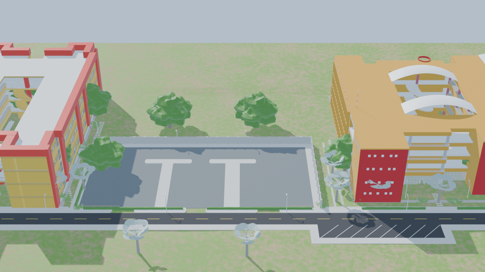
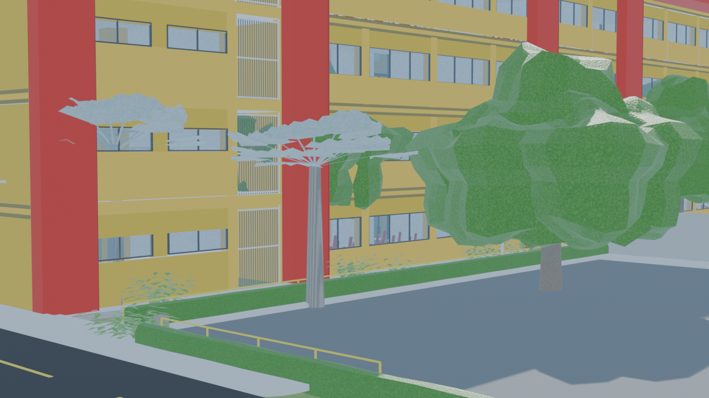
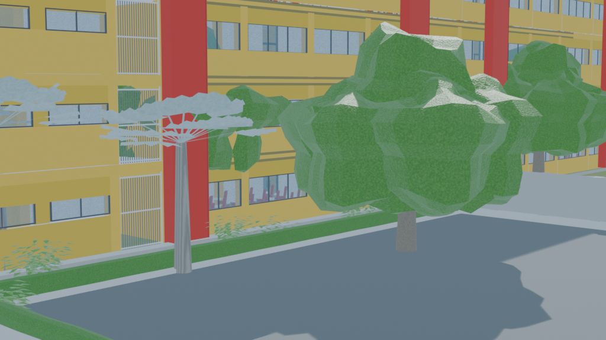

# Simulación Campus 3D - Universidad de La Guajira

> **Materia:** Simulación  
> **Institución:** Universidad de La Guajira (UniGuajira) — Sede Riohacha  
> **Facultad:** Facultad de Ingeniería  

---

## 👥 Equipo de Desarrollo

Este proyecto ha sido desarrollado para la materia de **Simulación** por los estudiantes:

* **Nolger Rodríguez**
* **Fredy Acosta**
* **Alberto Orozco**
* **Kenner Palma**

---

## 📌 Descripción del Proyecto

El presente proyecto consiste en el modelado tridimensional, unificación arquitectónica y diseño paisajístico del campus de la **Universidad de La Guajira**, concebido como un entorno tridimensional (*Sandbox / Diorama*) de alta fidelidad para simulaciones espaciales, peatonales y ambientales.

El modelo integra en escala real $1:1$ ($4.0\text{ m}$ por piso) los bloques académicos, el estacionamiento central y el sistema vial, complementado con la identidad ecológica y climática propia del ecosistema semiárido caribeño de Riohacha.



---

## 🏛️ Características del Entorno 3D

### 1. Unificación y Escala Arquitectónica
* **Bloque Uniguajira:** Bloque existente de aulas con muros amarillos, columnas cilíndricas, núcleos de escaleras rojas y celosías de ventilación.
* **Bloque Nuevo:** Bloque de aulas integrado al costado oeste del parqueadero con orientación frontal a la vía principal, escalado de forma precisa a las alturas reales de entrepiso ($4.0\text{ m}$).
* **Parqueadero Central:** Ubicado entre ambos edificios con pavimento asfáltico, señalización de bahías y muro perimetral continuo.

### 2. Base Sandbox / Diorama ($242\text{ m} \times 136\text{ m}$)
* Malla delimitada con márgenes de $35\text{ a }45\text{ m}$ a los costados y fondo, y $20\text{ m}$ al norte de la calzada.
* Zócalo perimetral limpio con caída vertical de $2.5\text{ m}$ para presentación tipo maqueta arquitectónica.
* Topografía interior con microdesniveles, taludes suaves y asentamiento exacto de cimentaciones.

### 3. Infraestructura Civil y Drenaje Pluvial
* **Vía y Aceras:** Calzada asfaltada continua de dos carriles con línea divisoria segmentada y andenes rematados al límite del sandbox.
* **Red de Canaletas Pluviales:** Sistema longitudinal modular con tapas prefabricadas de concreto ranurado (6 ranuras transversales) para captación de aguas pluviales.
* **Lechos de Canto Rodado (Piedra de Río):** Franjas de $1.20\text{ m}$ de ancho con shader y piedras 3D que protegen la base de las fachadas y muros de celosía.
* **Huellas Peatonales:** Circuitos de losas discontinuas de concreto ($0.70\text{ m} \times 0.45\text{ m}$) que conectan la calzada con las entradas y el parqueadero.



### 4. Paisajismo y Vegetación Caribeña Autóctona
* **Shader PBR de Suelo Riohacha:** Textura procedimental multiescala que combina tierra arenosa ocre rojiza con césped rústico tropical no uniforme.
* **Setos Vivos Podados:** Líneas de setos de $0.60\text{ m} \times 0.85\text{ m}$ que acompañan los andenes, rampa peatonal y desniveles.
* **Macizos de Arbustos Tropicales:** Especies de hoja ancha cerosa (*Ficus*, *Philodendron*) en esquinas de edificios, portales y torres de escaleras rojas.
* **Árboles de Mango (*Mangifera indica*):** Árboles de copa globosa densa ($8\text{ a }10\text{ m}$ de envergadura) que proyectan sombras sobre fachadas y jardines.
* **Palmas Bismarckia (*Bismarckia nobilis*):** Palmas emblemáticas con frondas costapalmadas en abanico plateado-azulado dispuestas en los taludes de césped junto a la calle.

### 5. Mobiliario Urbano y Accesos
* **Luminarias de Campus:** Postes metálicos de $4.80\text{ m}$ con brazo diagonal angular y cabezal LED plano.
* **Barandas de Seguridad Amarillas:** Estructura tubular en amarillo tráfico reflectivo para protección en cambios de nivel y rampas.
* **Detalles en Puertas:** Maceteros cilíndricos de terracota con plantas ornamentales y canecas de basura industriales en accesos peatonales.



---

## 📂 Estructura del Repositorio

```text
├── README.md                          # Documentación del proyecto
├── .gitignore                         # Exclusión de temporales de Blender (*.blend1, etc.)
├── modelos/
│   └── campus_uniguajira.blend        # Archivo maestro 3D consolidado
└── img/
    ├── sandbox_final_campus.png       # Vista aérea isométrica general
    ├── sandbox_final_peatonal.png     # Perspectiva peatonal y vial
    └── sandbox_paso9_perspectiva.png  # Detalle de arbolado y jardines
```

---

## 🛠️ Requisitos y Uso del Modelo

1. **Software recomendado:** [Blender](https://www.blender.org/) versión **4.2 LTS** o **5.x**.
2. **Abrir el modelo:**
   - Navegar a la carpeta `modelos/`.
   - Abrir el archivo `campus_uniguajira.blend`.
3. **Modos de visualización:**
   - **Material Preview (Viewport Shading):** Para navegación ágil e inspección de texturas PBR y vegetación.
   - **Rendered (Cycles / EEVEE):** Para visualización con iluminación solar y cúpula celeste caribeña.
